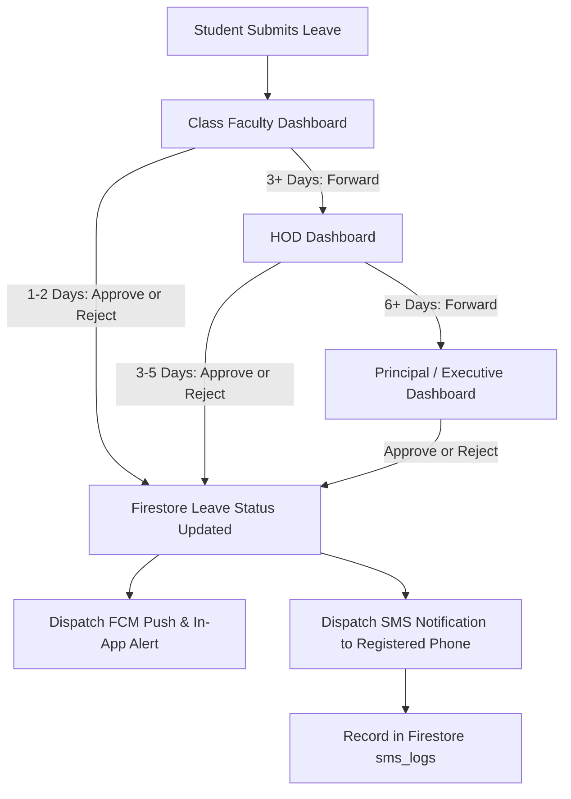

# Institutional Leave Tracker: Bug Fixes, UI/UX Overhaul & SMS Alerts Implementation Plan

> **For agentic workers:** REQUIRED SUB-SKILL: Use superpowers:subagent-driven-development (recommended) or superpowers:executing-plans to implement this plan task-by-task. Steps use checkbox (`- [ ]`) syntax for tracking.

**Goal:** Implement strict institutional authorization, class advisor and HOD dashboard updates, real-time SMS notification alerts upon approval/rejection, elimination of "aislop" and contrast/visibility bugs, approver name tag cleanup on student records, and verification of academic session cookies and privacy settings.

**Architecture:** Client-side React 18 + TypeScript + Vite architecture powered by Firebase Authentication and Cloud Firestore, secured via strict domain-level authorization guards and Firestore Security Rules. SMS delivery is handled through a unified SMS notification abstraction (`src/lib/sms.ts`) integrated into multi-tier approval actions and logged to Firestore.

**Tech Stack:** React 18, TypeScript, Tailwind CSS, Firebase (Auth, Firestore, Cloud Messaging), Lucide Icons, Framer Motion, Sonner, Zod, Date-fns.

---

## Global Constraints

- **Official College Domain:** All logins and registrations must strictly adhere to `@sriniet.edu.in`.
- **Institutional Identity:** Srinivasa Institute of Engineering & Technology (Autonomous), NH-216, Cheyyeru, Amalapuram, AP. No placeholder names (e.g., removing erroneous "Sri Shakthi" labels).
- **Design Tokens:** Strict glassmorphic depth (`bg-white/90 dark:bg-zinc-900/90 backdrop-blur-md`), maroon primary (`#8B1A1A`), amber accent (`#F7941D`), and high-contrast WCAG 2.1 AA accessible text on all interactive controls.
- **Zero Placeholder / Fluff:** Remove all AI-generated buzzwords ("Leave Intelligence", "Live Absentee Engine", etc.) and format as a crisp, authoritative institutional management system.

---

## User Review Required

> [!IMPORTANT]
> **SMS Gateway Configuration:**
> In client applications, real SMS dispatch requires gateway credentials (e.g., Fast2SMS, Twilio, or institutional SMS HTTP webhook). We implement an SMS engine (`src/lib/sms.ts`) that reads `VITE_SMS_GATEWAY_URL` and `VITE_SMS_API_KEY` from `.env`. When configured, it dispatches live SMS HTTP requests; in local/demo mode, it seamlessly logs all dispatched SMS alerts to a dedicated Firestore collection (`sms_logs`) and displays a confirmed toast notification with the SMS message payload so testing works reliably out of the box.

> [!NOTE]
> **Approver Role Tag Cleanup:**
> In the student leave audit view (`LeaveAuditStepper.tsx`), the previous display logic prepended `[{entry.stage.toUpperCase()}]` and appended `({entry.approverRole})`, generating redundant strings like `[FACULTY] B. Manohar (faculty)`. This will be updated to display the clean name: `B. Manohar` accompanied by a professional subtext indicating their official role (e.g. `Class Advisor` or `Head of Department`), eliminating all bracketed tags around the approver's name.

---

## Open Questions

None at this stage; all 5 actionable requirements have been pinpointed within the codebase files.

---

## Proposed Changes



---

### Component 1: Authorization & Security Hardening

Enforce that ONLY verified, authorized college accounts can access the application.

#### [MODIFY] [src/routes/AppRouter.tsx](file:///home/supreme/Documents/Project/Web/SIET/src/routes/AppRouter.tsx)
- In `ProtectedRoute`:
  - Validate that `user.email` strictly ends with `@sriniet.edu.in`.
  - Check for active valid session cookie via `getActiveSessionToken()`.
  - If unauthorized or session is missing/tampered, trigger `auth.signOut()`, notify the user with an authorization error, and redirect to `/login`.

#### [MODIFY] [firestore.rules](file:///home/supreme/Documents/Project/Web/SIET/firestore.rules)
- Add domain validation helper:
  ```cel
  function isAuthorizedCollegeUser() {
    return request.auth != null && request.auth.token.email.matches('.*@sriniet[.]edu[.]in$');
  }
  ```
- Guard `/users/{userId}`, `/leaveRequests/{leaveId}`, `/facultyLeaveRequests/{leaveId}`, and `/departmentWorkingDays/{docId}` with `isAuthorizedCollegeUser()`.
- Prevent users from elevating their own role during write operations.

---

### Component 2: Dashboard Modifications (Faculty & HOD Views)

Explicitly distinguish student pending approvals on both Faculty and HOD views.

#### [MODIFY] [src/components/layout/Menubar.tsx](file:///home/supreme/Documents/Project/Web/SIET/src/components/layout/Menubar.tsx)
- Faculty Navigation:
  - Rename item `"Pending Approvals"` → `"Student Pending Approvals"`.
- HOD Navigation:
  - Rename `"Pending Approvals"` → `"Student Leave Approvals"`.
  - Rename `"Faculty Leaves"` → `"Faculty Leave Approvals"`.
  - Add real-time badge count support for both queues.

#### [MODIFY] [src/pages/faculty/FacultyDashboard.tsx](file:///home/supreme/Documents/Project/Web/SIET/src/pages/faculty/FacultyDashboard.tsx)
- Update KPI card from generic `"Pending Review"` to `"Pending Student Approvals"`.
- Update Quick Link Card:
  - Heading: `"You have {pendingLeaves.length} student leave application(s) awaiting review"`
  - Button text: `"Review Student Approvals"`.

#### [MODIFY] [src/pages/faculty/FacultyApprovals.tsx](file:///home/supreme/Documents/Project/Web/SIET/src/pages/faculty/FacultyApprovals.tsx)
- Update title and description to `"Student Leave Approvals (Class Advisor)"`.
- Empty state copy: `"No pending student leave applications for your class."`

#### [MODIFY] [src/pages/hod/HodDashboard.tsx](file:///home/supreme/Documents/Project/Web/SIET/src/pages/hod/HodDashboard.tsx)
- Replace generic `"Pending Desk"` button in the action header with two distinct, styled action buttons:
  1. `"Student Leave Approvals"` (`/hod/approvals`) with pending student count.
  2. `"Faculty Leave Approvals"` (`/hod/faculty-approvals`) with pending faculty count.
- Add live listener for pending faculty leave requests count alongside student leaves so both badges reflect real-time numbers.
- Update KPI card title from `"Pending HOD Review"` to `"Pending Student Approvals"` and add a dedicated metric card or subtext for `"Pending Faculty Leaves"`.

#### [MODIFY] [src/pages/hod/Approvals.tsx](file:///home/supreme/Documents/Project/Web/SIET/src/pages/hod/Approvals.tsx)
- Page title: `"Student Leave Approvals Desk"`.
- Subtitle: `"Review and authorize extended student leave applications (3–5 days) or endorse for Principal clearance"`.

#### [MODIFY] [src/pages/hod/HodFacultyApprovals.tsx](file:///home/supreme/Documents/Project/Web/SIET/src/pages/hod/HodFacultyApprovals.tsx)
- Title: `"Faculty Leave Approvals Desk"`.

---

### Component 3: SMS Notification System

Send SMS notifications whenever a leave request is approved or rejected.

#### [NEW] [src/lib/sms.ts](file:///home/supreme/Documents/Project/Web/SIET/src/lib/sms.ts)
- Implement `sendLeaveSmsNotification`:
  ```typescript
  export interface SmsNotificationPayload {
    recipientPhone: string;
    recipientName: string;
    leaveType: string;
    startDate: string;
    endDate: string;
    status: "approved" | "rejected";
    approverName: string;
    approverRole: string;
    remarks?: string;
    leaveId?: string;
    recipientUid?: string;
  }
  ```
- Clean institutional SMS text:
  `[SIET LEAVE DESK] Dear {recipientName}, your {leaveType} leave application ({startDate} to {endDate}) has been {STATUS} by {approverRole} ({approverName}). {remarks ? 'Remarks: ' + remarks : ''}`
- Dispatches HTTP request if gateway is set, or writes to Firestore `sms_logs` collection.
- Triggers sonner toast: `SMS alert dispatched to +91-XXXXX`.

#### [MODIFY] [src/pages/faculty/FacultyApprovals.tsx](file:///home/supreme/Documents/Project/Web/SIET/src/pages/faculty/FacultyApprovals.tsx)
- On approve (1-2 days) or reject: call `sendLeaveSmsNotification` using `selectedLeave.emergencyPhone` or student registered phone.

#### [MODIFY] [src/pages/hod/Approvals.tsx](file:///home/supreme/Documents/Project/Web/SIET/src/pages/hod/Approvals.tsx)
- In `handleApprove` and `handleRejectSubmit`: invoke `sendLeaveSmsNotification` to alert the student via SMS immediately.

#### [MODIFY] [src/pages/admin/AdminApprovals.tsx](file:///home/supreme/Documents/Project/Web/SIET/src/pages/admin/AdminApprovals.tsx)
- In `handleAction`: dispatch `sendLeaveSmsNotification` for Principal approved or rejected leaves.

#### [MODIFY] [src/pages/hod/HodFacultyApprovals.tsx](file:///home/supreme/Documents/Project/Web/SIET/src/pages/hod/HodFacultyApprovals.tsx)
- In `handleAction`: dispatch `sendLeaveSmsNotification` to the faculty member's registered phone number upon approval or rejection.

---

### Component 4: UI/UX Front-End Improvements, Approver Tag Cleanup & Aislop Removal

Remove bracketed approver tags, fix button visibility, and remove marketing fluff.

#### [MODIFY] [src/components/leave/LeaveAuditStepper.tsx](file:///home/supreme/Documents/Project/Web/SIET/src/components/leave/LeaveAuditStepper.tsx)
- Lines 98-99: Replace:
  ```tsx
  <span>
    [{entry.stage.toUpperCase()}] {entry.approverName} ({entry.approverRole})
  </span>
  ```
  With clean, professional approver formatting:
  ```tsx
  <div className="flex items-center gap-2">
    <span className="font-bold text-foreground text-xs">{entry.approverName}</span>
    <span className="text-[10px] text-muted-foreground font-medium">
      • {formatApproverRole(entry.stage, entry.approverRole)}
    </span>
  </div>
  ```
  And line 76: replace `${chainEntry.action.toUpperCase()} (${chainEntry.approverName})` with clean format without bracketed tags.

#### [MODIFY] [src/components/ui/button.tsx](file:///home/supreme/Documents/Project/Web/SIET/src/components/ui/button.tsx)
- Update `outline` and `ghost` variants to ensure high contrast in both light and dark modes:
  ```tsx
  outline: "border border-zinc-300 dark:border-zinc-700 bg-white dark:bg-zinc-850 text-zinc-800 dark:text-zinc-100 hover:bg-zinc-100 dark:hover:bg-zinc-800 hover:text-zinc-900 dark:hover:text-white shadow-xs",
  ```

#### [MODIFY] [src/pages/student/MyLeaves.tsx](file:///home/supreme/Documents/Project/Web/SIET/src/pages/student/MyLeaves.tsx)
- Fix the Withdraw button contrast:
  - Previous: `text-zinc-600 hover:text-red-600 hover:bg-red-50 border-zinc-200` (invisible in dark mode!).
  - New: `text-zinc-700 dark:text-zinc-200 hover:text-red-600 dark:hover:text-red-400 hover:bg-red-50 dark:hover:bg-red-950/40 border-zinc-200 dark:border-zinc-700`.

#### [MODIFY] [src/components/common/CookieConsentBanner.tsx](file:///home/supreme/Documents/Project/Web/SIET/src/components/common/CookieConsentBanner.tsx)
- Replace hallucinated `"Sri Shakthi Institute of Engineering & Technology"` with `"Srinivasa Institute of Engineering & Technology (Autonomous)"`.
- Ensure buttons have strong contrast (`Essential Only` and `Accept All & Proceed`).

#### [MODIFY] [src/pages/Landing.tsx](file:///home/supreme/Documents/Project/Web/SIET/src/pages/Landing.tsx)
- Clean up AI buzzwords:
  - Replace `"SIET Leave Intelligence"` and `"Live Absentee Engine"` with `"Srinivasa Institute of Engineering & Technology — Student & Faculty Leave Portal"`.
  - Remove AI marketing jargon, clean up badges, and ensure all buttons and CTAs have bold contrast and clear typography.

#### [MODIFY] [src/components/auth/AuthDynamicSidePanel.tsx](file:///home/supreme/Documents/Project/Web/SIET/src/components/auth/AuthDynamicSidePanel.tsx)
- Clean up labels and ensure crisp, dignified institutional branding.

---

### Component 5: Privacy Settings & Academic Session Cookies

Verify and enhance session persistence, cookie security, and telemetry.

#### [MODIFY] [src/lib/session.ts](file:///home/supreme/Documents/Project/Web/SIET/src/lib/session.ts) & [src/lib/cookies.ts](file:///home/supreme/Documents/Project/Web/SIET/src/lib/cookies.ts)
- Verify `SameSite=Lax`, `Secure` when on HTTPS, expiration timestamps.
- Provide `validateAcademicSession()` helper to check cookie existence and freshness.
- Connect session termination on user signout (`clearSessionData()`).

---

## Verification Plan

### Automated Tests & Compilation Verification
1. Run TypeScript check and production build:
   ```bash
   npm run build
   ```
   *Expected: Exit code 0, 0 type errors.*

2. Run ESLint:
   ```bash
   npm run lint
   ```
   *Expected: 0 lint errors.*

### Manual Verification Flow
1. **Authorization & Domain Guard:**
   - Attempt to access `/student/dashboard`, `/faculty/dashboard`, or `/hod/dashboard` without login. Verify redirection to `/login`.
   - Verify that non `@sriniet.edu.in` attempts are rejected.
2. **Dashboard Labels:**
   - Log into Faculty account: confirm Menubar shows "Student Pending Approvals" and dashboard cards display student approval queue.
   - Log into HOD account: confirm Menubar and Dashboard show distinct "Student Leave Approvals" and "Faculty Leave Approvals" with live badges.
3. **SMS Notification Alert:**
   - As Faculty/HOD, approve or reject a leave.
   - Confirm sonner notification confirms SMS alert sent to registered phone number.
   - Confirm record created in Firestore `sms_logs`.
4. **Student Page Approver Name Display:**
   - Open student `/student/leaves` page.
   - Inspect the Leave Audit Stepper on approved/rejected requests.
   - Verify `B. Manohar` (or any approver name) is displayed cleanly without `[FACULTY]` before or after.
5. **Button Colors & Contrast:**
   - Toggle Dark Mode and Light Mode on all dashboards, modals, tables, and buttons.
   - Verify all buttons (Withdraw, Approve, Reject, Cancel, Print Pass) have distinct, legible text and borders.
6. **Privacy & Cookies:**
   - Open Cookie consent banner, test "Essential Only" and "Accept All & Proceed", check cookies in browser storage.
