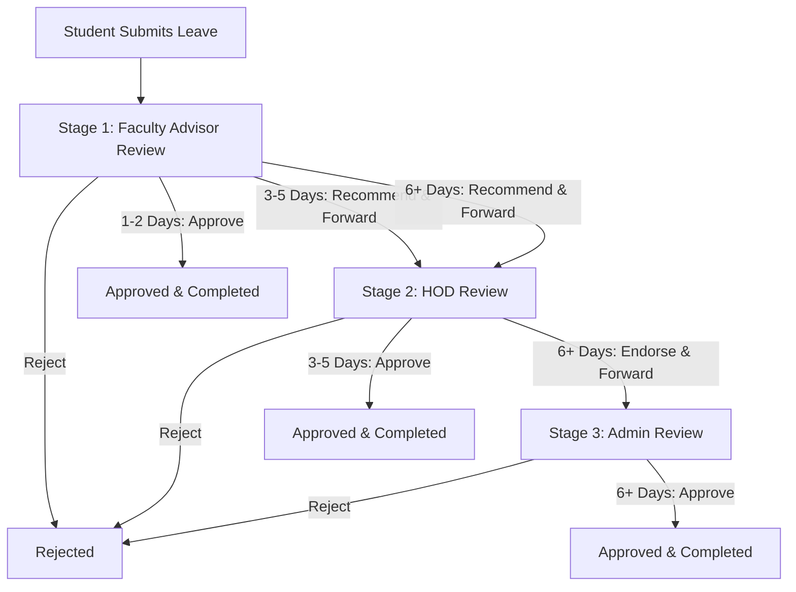

# SIET Leave Tracker — Multi-Tier Approval System Specification (Faculty → HOD → Admin)

## Executive Summary
This document specifies the architectural enhancement to the **SIET Leave Tracker (Srinivasa Institute of Engineering & Technology, Cheyyeru)** to transition from a 2-tier model (Student → HOD) to a complete 4-role institutional hierarchy:
**Student → Faculty (Class Advisor) → HOD (Department Head) → Admin (Principal/Dean)**.

Leaves are auto-routed dynamically based on the total leave duration, establishing clear delegated authority and audit trails.

---

## 1. Role Definitions & Hierarchy

| Role | Title in System | Organizational Scope | Primary Responsibilities |
| :--- | :--- | :--- | :--- |
| **`student`** | Student | Specific Dept, Year, Section | Applies for leave, attaches certificates, tracks multi-stage approval status. |
| **`faculty`** | Class Advisor / Faculty | Assigned Dept, Year, Section (e.g. CSE Year 3 Sec A) | First line of review for their class students. Full authority for short leaves (1–2 days); forwards longer leaves to HOD. |
| **`hod`** | Head of Department | Entire Department (e.g. CSE) | Reviews leaves escalated by Faculty. Full authority for medium leaves (3–5 days); forwards institutional leaves (6+ days) to Admin. Manages faculty class allocations. |
| **`admin`** | Principal / Dean / Academic Cell | Entire Institution (All Departments) | Final decision maker for extended leaves (6+ days). Oversees college-wide analytics, manages user roles, and audits leave policies. |

---

## 2. Duration-Based Escalation Matrix

When a student submits a leave application, the initial stage is always **Stage 1 (Faculty Advisor)**. The actions available at each stage depend strictly on the computed `totalDays`:



### Decision Rules Table:

| Leave Duration | Initial Stage | Faculty Actions | HOD Actions | Admin Actions |
| :--- | :--- | :--- | :--- | :--- |
| **1–2 Days** | Faculty Advisor | ✅ **Approve** (Final) <br/> ❌ **Reject** | *N/A (Read-only visibility in department archive)* | *N/A (Read-only visibility)* |
| **3–5 Days** | Faculty Advisor | ⬆️ **Forward to HOD** (with advisor remarks) <br/> ❌ **Reject** | ✅ **Approve** (Final) <br/> ❌ **Reject** | *N/A (Read-only visibility)* |
| **6+ Days** (1 week+) | Faculty Advisor | ⬆️ **Forward to HOD** (with advisor remarks) <br/> ❌ **Reject** | ⬆️ **Forward to Admin** (with HOD endorsement) <br/> ❌ **Reject** | ✅ **Approve** (Final) <br/> ❌ **Reject** |

---

## 3. Data Schema & Models

### 3.1 User Model (`users/{uid}`)

```typescript
export type UserRole = "student" | "faculty" | "hod" | "admin";

export interface UserData {
  uid: string;
  email: string;
  name: string;
  role: UserRole;
  department: "CSE" | "ECE" | "EEE" | "ME" | "CE" | "S&H" | "ADMIN";
  phone: string;
  createdAt?: any;
  updatedAt?: any;

  // Student Attributes
  rollNumber?: string;
  year?: number;       // 1 | 2 | 3 | 4
  semester?: number;   // 1 | 2
  section?: string;    // "A" | "B" | "C" | "D"

  // Faculty Attributes
  employeeId?: string;
  assignedYear?: number;      // e.g. 3
  assignedSection?: string;   // e.g. "A"
  designation?: string;       // e.g. "Assistant Professor & Class Advisor"

  // HOD Attributes
  // employeeId, department

  // Admin Attributes
  adminLevel?: "principal" | "dean" | "academic_cell";
}
```

### 3.2 Leave Request Model (`leaveRequests/{docId}`)

```typescript
export type LeaveStatus =
  | "pending_faculty"
  | "pending_hod"
  | "pending_admin"
  | "approved"
  | "rejected"
  | "cancelled";

export type ApproverStage = "faculty" | "hod" | "admin" | "completed";

export interface ApprovalChainEntry {
  stage: "faculty" | "hod" | "admin";
  action: "approved" | "forwarded" | "rejected";
  approverUid: string;
  approverName: string;
  approverRole: UserRole;
  remarks: string;
  timestamp: any; // Firestore Timestamp
}

export interface LeaveRequest {
  id?: string;
  studentUid: string;
  studentName: string;
  rollNumber: string;
  department: string;
  year: number;
  section: string;

  type: "Medical" | "Personal" | "Half-Day" | "Emergency" | "On-Duty";
  startDate: any; // Timestamp
  endDate: any;   // Timestamp
  totalDays: number;
  reason: string;
  emergencyPhone: string;
  attachmentUrl?: string | null;

  // Multi-tier State Tracking
  status: LeaveStatus;
  currentApprover: ApproverStage;
  finalAuthority: "faculty" | "hod" | "admin"; // Derived automatically on submission

  // Step-by-Step Audit Ledger
  approvalChain: ApprovalChainEntry[];

  // Direct Remarks for Quick Queries
  facultyRemarks?: string;
  hodRemarks?: string;
  adminRemarks?: string;

  createdAt: any;
  updatedAt: any;
}
```

---

## 4. Portals & User Interface Architecture

### 4.1 Student Portal Enhancements
- **Submit Leave (`/student/apply`)**: Shows clear duration guidance banner:
  - 1-2 days: "Decided by Class Advisor"
  - 3-5 days: "Class Advisor → HOD Review"
  - 6+ days: "Class Advisor → HOD → Principal Approval"
- **My Leaves (`/student/leaves`)**: Interactive Visual Stepper / Status Stepper showing each stage in the chain:
  - Step 1: Faculty Review (Pending / Forwarded / Approved / Rejected)
  - Step 2: HOD Review (if >= 3 days)
  - Step 3: Admin Review (if >= 6 days)
  - Shows reviewer comments and timestamps at each step.

### 4.2 Faculty Portal (`/faculty/*`)
- **Dashboard (`/faculty/dashboard`)**:
  - Class Overview: Total students in assigned Year & Section.
  - KPI Cards: Pending Class Requests, Approved by Faculty, Forwarded to HOD, Rejected.
  - Today's Absentees summary for the assigned class.
- **Approvals (`/faculty/approvals`)**:
  - Filtered by `department == user.department && year == user.assignedYear && section == user.assignedSection && status == "pending_faculty"`.
  - Action Sheet / Modal:
    - If `totalDays <= 2`: **[Approve Leave]** and **[Reject Leave]** buttons.
    - If `totalDays >= 3`: **[Forward to HOD with Remarks]** and **[Reject Leave]** buttons.
- **Archive / History (`/faculty/history`)**: Full log of all leaves handled for the class.
- **Profile (`/faculty/profile`)**: Faculty credentials and class advisory details.

### 4.3 HOD Portal Enhancements (`/hod/*`)
- **Dashboard (`/hod/dashboard`)**:
  - Upgraded with class-by-class comparison and multi-tier metrics (Leaves Forwarded by Faculty, Leaves Escalated to Admin).
- **Approvals (`/hod/approvals`)**:
  - List of leaves with `department == user.department && status == "pending_hod"`.
  - Shows Faculty Advisor's prior remarks and endorsement details.
  - Action Sheet / Modal:
    - If `totalDays <= 5`: **[Approve Leave]** and **[Reject Leave]** buttons.
    - If `totalDays >= 6`: **[Forward to Admin with Endorsement]** and **[Reject Leave]** buttons.
- **Faculty Management (`/hod/faculty`)**:
  - Assign Faculty members to specific Year & Section pairs (e.g., Year 2 Sec B, Year 4 Sec A).

### 4.4 Admin Portal (`/admin/*`)
- **Dashboard (`/admin/dashboard`)**:
  - College-wide attendance & leave statistics across all 6 departments.
  - Department leave distribution (CSE vs ECE vs ME vs CE vs EEE vs S&H).
  - High-duration leaves summary.
- **Approvals (`/admin/approvals`)**:
  - Leaves requiring Principal/Dean clearance: `status == "pending_admin"`.
  - Full audit trail visible: Student reason + Faculty remarks + HOD endorsement.
  - Actions: **[Grant Institutional Approval]** or **[Reject]**.
- **All Requests (`/admin/all-requests`)**:
  - Multi-department filterable table with export to CSV and print-ready summary.
- **User Management (`/admin/manage-users`)**:
  - View all registered accounts.
  - Assign/change roles (`student`, `faculty`, `hod`, `admin`).
  - Assign departments and class advisors.
- **Admin Profile (`/admin/profile`)**:
  - Administrative contact and settings.

---

## 5. Security & Access Control (Firestore Rules)

```javascript
rules_version = '2';
service cloud.firestore {
  match /databases/{database}/documents {
    
    function getUser() {
      return get(/databases/$(database)/documents/users/$(request.auth.uid)).data;
    }
    
    function isAdmin() {
      return request.auth != null && getUser().role == "admin";
    }
    
    function isHOD() {
      return request.auth != null && getUser().role == "hod";
    }
    
    function isFaculty() {
      return request.auth != null && getUser().role == "faculty";
    }

    // Users collection
    match /users/{userId} {
      allow read: if request.auth != null;
      allow create: if request.auth != null && request.auth.uid == userId;
      allow update: if request.auth != null && (request.auth.uid == userId || isAdmin());
      allow delete: if isAdmin();
    }

    // Leave Requests collection
    match /leaveRequests/{leaveId} {
      allow read: if request.auth != null && (
        resource.data.studentUid == request.auth.uid ||
        isFaculty() ||
        isHOD() ||
        isAdmin()
      );

      // Student can submit leave
      allow create: if request.auth != null && request.resource.data.studentUid == request.auth.uid;

      // Updating leave:
      // - Student can cancel if still pending_faculty
      // - Faculty can update if status is pending_faculty
      // - HOD can update if status is pending_hod
      // - Admin can update if status is pending_admin or override
      allow update: if request.auth != null && (
        (resource.data.studentUid == request.auth.uid && request.resource.data.status == "cancelled") ||
        (isFaculty() && resource.data.status == "pending_faculty") ||
        (isHOD() && (resource.data.status == "pending_hod" || resource.data.department == getUser().department)) ||
        isAdmin()
      );

      allow delete: if isAdmin();
    }

    // Department working days & config
    match /departmentWorkingDays/{docId} {
      allow read: if request.auth != null;
      allow write: if isHOD() || isAdmin();
    }
  }
}
```

---

## 6. Verification and Validation Criteria
1. **Type Safety & Build**: Clean compile with `tsc -b` and zero type errors across all four roles.
2. **Role Boundaries**: Student cannot access Faculty/HOD/Admin pages; Faculty cannot access HOD/Admin pages; HOD cannot access Admin pages.
3. **Escalation Accuracy**:
   - 1-day leave stops at Faculty (Approve -> status "approved").
   - 4-day leave: Faculty has Forward only; HOD has Approve -> status "approved".
   - 7-day leave: Faculty forwards to HOD; HOD forwards to Admin; Admin approves -> status "approved".
4. **Visual Quality**: Glassmorphic panels, SIET institutional maroon tokens (`#8B1A1A`), dark mode support, and Framer Motion micro-animations with zero layout shift.
